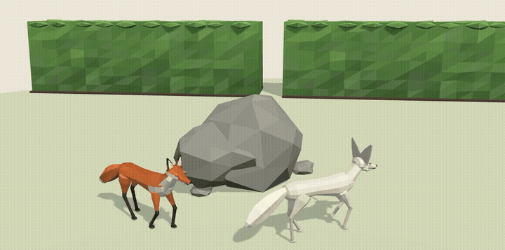

# Gaitkit examples

Working examples for [Gaitkit](https://gaitkit.com): low-poly 3D models written as code, many of which move. Creatures
and mechs walk on procedural IK legs, vehicles roll their wheels with distance, doors and lids turn on real hinges.
Every model is an ES module for three.js and a GLB with its animation clip for any engine; AI coding agents can fetch them
over MCP.

| Example | What it shows | Run |
|---|---|---|
| [`threejs-walking-fox`](threejs-walking-fox) | ES modules from the CDN, knobs, distance-driven IK walking along a path | `npx serve threejs-walking-fox` |
| [`react-three-fiber`](react-three-fiber) | GLB + `useGLTF` + `useAnimations`, clip speed matched to movement | `cd react-three-fiber && npm i && npm run dev` |
| [`godot`](godot) | GLB import, `AnimationPlayer`, the Walk clip at the right speed, a headless check | open `godot/` in Godot 4.3+ |
| [`agents`](agents) | MCP setup for Claude Code, Cursor, VS Code and Codex, plus prompts to try | see the folder |

All examples use **free** models, so they run without an account.

## How Gaitkit models work

- **Code first.** `createAsset(knobs)` returns a `THREE.Group`. Knobs are typed (choice, range, toggle, colour) and each
  one has a plain-words description, so `get_variant` can turn "arctic white with big ears" into `{ coat: 'arctic', ears: 1.8 }`.
- **Real scale.** Metres, Y up, resting on y = 0, front facing +Z. Models from different kits sit together without rescaling.
- **Motion as data.** Walkers carry their gait (stride, duty factor, leg phases); `walker(model).poseAt(distance)` poses the
  legs for any distance walked, and planted feet slide less than 1 mm. GLBs carry an in-place `Walk` or `Loop` clip.
- **Small.** At most 6,000 triangles, flat-shaded vertex colours, no textures.

Browse the catalogue at https://gaitkit.com/assets, read the [docs](https://gaitkit.com/docs) and the
[guides](https://gaitkit.com/guides), or connect your agent: `claude mcp add --transport http gaitkit https://gaitkit.com/mcp`.

## Licence

The example code is MIT ([LICENSE](LICENSE)). The 3D models are covered by the [Gaitkit licence](https://gaitkit.com/license):
use them in your own games, apps and client work without credit; do not resell them as assets or train 3D generators on
them. See [MODELS.md](MODELS.md).
