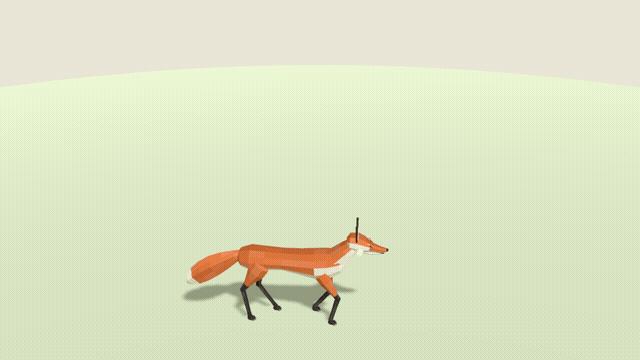

# Walking fox in Godot 4

A Gaitkit GLB in Godot: the fox walks a circle and plays its own **Walk** clip at a speed matched to how fast it moves,
so its paws stay planted.



Open the `godot` folder in Godot 4.3 or later (tested on 4.7.2) and press Play. Godot imports `models/fox.glb` as a scene
with an `AnimationPlayer` that holds the clip.

The whole example is `main.gd`:

- `preload("res://models/fox.glb").instantiate()` brings in the fox: metres, Y up, front facing +Z, one material per colour.
- `player.speed_scale = speed / CLIP_SPEED` matches the clip to the walking speed. `CLIP_SPEED` is the model's
  `gait.clip_speed` (0.375 m/s for the fox), shown on [its page](https://gaitkit.com/asset/fox) and returned by the
  MCP tool `get_asset`.
- `fox.rotation.y = angle + PI / 2` turns the fox along its path, because Gaitkit models face +Z.

Vehicles, flyers and swimmers carry a `Loop` clip instead: one cycle per `loop_m` metres, so play it at `speed / loop_m`.

Headless check (what we run before publishing):

```sh
godot --headless --path godot --import
godot --headless --path godot -s res://tests/check.gd    # prints "... -> OK" and exits 0
```

Guide: [Import an animated low-poly GLB into Godot 4](https://gaitkit.com/guides/godot-animated-glb).
